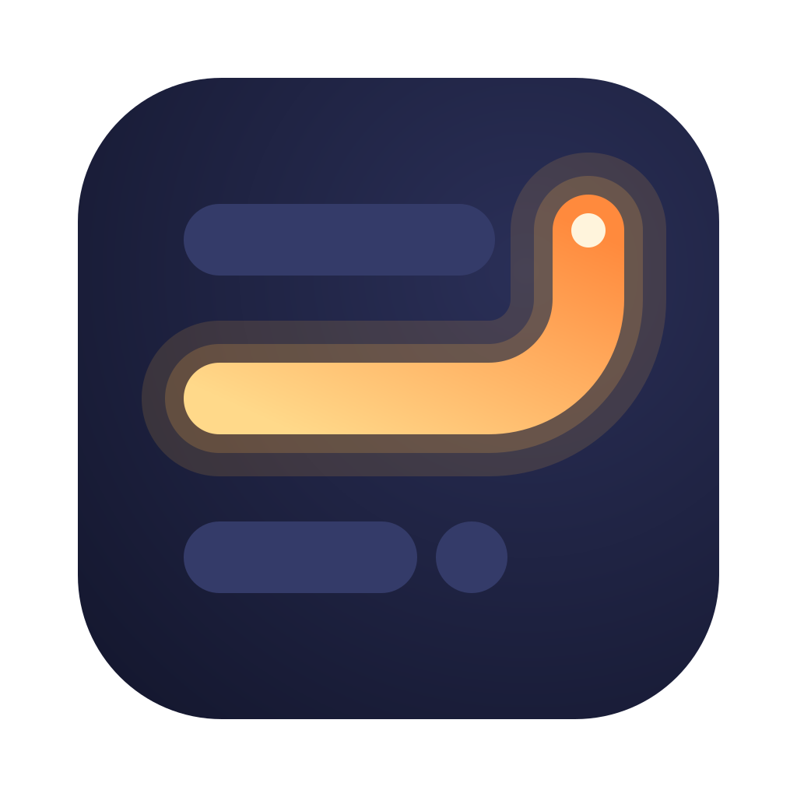
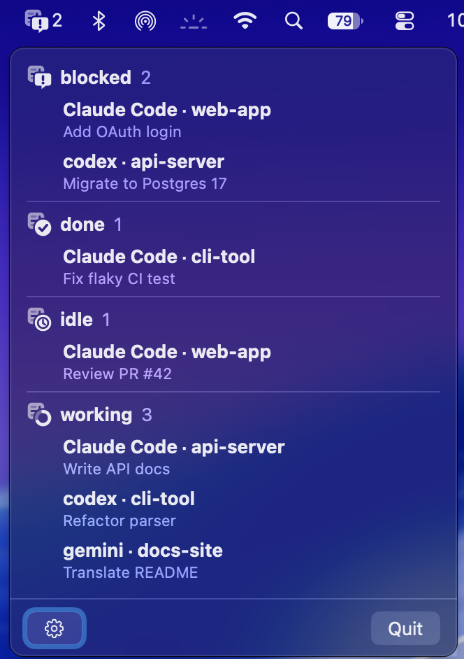
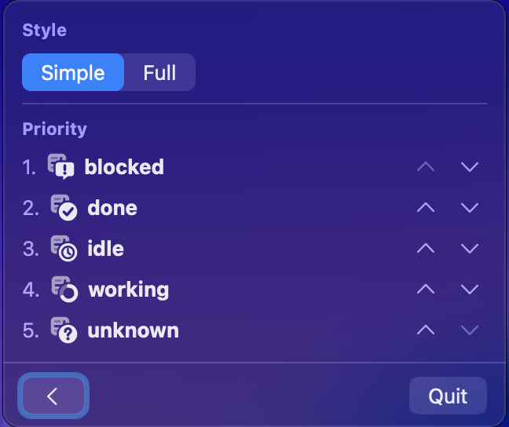

<h1 align="center">
  
  turnray
</h1>

<p align="center">
  <b>See whose turn it is — your AI agents' status, right in the macOS menu bar.</b>
</p>

<p align="center">
  
</p>

turnray watches the AI agents running under herdr, kitty or Rex, and Claude Code and Codex
sessions anywhere through a plugin, and tells you, from the menu bar, which ones are
waiting for you — without changing your terminal layout. The name is *turn*
(your turn) + *tray*.

## Features

- **At-a-glance status** — the menu bar shows how many agents are in each status, most
  urgent first
- **Agent list** — click the icon for every agent with its workspace and title, grouped by
  status
- **Your priority** — reorder the statuses to decide which one the menu bar puts first
- **Live** — updates every second, and warns you when herdr can't be reached
- **kitty too** — Claude Code and Codex in kitty windows show up without a plugin
  ([kitty](#kitty))
- **Rex too** — so do Claude Code and Codex in Rex's terminal blocks ([Rex](#rex))
- **Works without herdr** — a plugin reports Claude Code or Codex sessions in any
  terminal ([Claude Code without herdr](#claude-code-without-herdr),
  [Codex without herdr](#codex-without-herdr))

## Requirements

- macOS
- herdr, running ([how turnray finds it](#how-turnray-finds-herdr)), kitty 0.50.0 or later
  with [remote control on](#kitty), [Rex](#rex), or the
  [Claude Code plugin](#claude-code-plugin) or [Codex plugin](#codex-plugin) for sessions
  outside herdr

## Install

### Homebrew

```sh
brew install --cask muleyuck/tap/turnray
```

### Manual

1. Download `turnray-<version>.zip` from
   [Releases](https://github.com/muleyuck/turnray/releases) and unzip it
2. Move `turnray.app` to `/Applications`
3. Clear the quarantine flag. The app is ad-hoc signed, not notarized, so Gatekeeper
   blocks it otherwise:

   ```sh
   xattr -dr com.apple.quarantine /Applications/turnray.app
   ```

To start turnray at login, check **Launch at login** in the panel's [settings](#settings).
On macOS 12 and earlier, add it in **System Settings > General > Login Items** instead.

### Claude Code plugin

To show Claude Code sessions that don't run under herdr, install the plugin after
turnray itself:

```sh
claude plugin marketplace add muleyuck/turnray
claude plugin install turnray@turnray
```

- `turnray.app` must be in `/Applications` or `~/Applications`, and built by a version
  that includes this feature. Otherwise the plugin finds nothing and does nothing
- Third-party marketplaces don't auto-update by default. Update with
  `claude plugin update turnray@turnray`, or turn auto-update on for the marketplace
- Remove it with `claude plugin uninstall turnray@turnray`. Deleting the app leaves the
  plugin installed, but it does nothing without the app

### Codex plugin

To show Codex sessions that don't run under herdr, install the plugin after turnray
itself:

```sh
codex plugin marketplace add muleyuck/turnray
codex plugin add turnray@turnray
```

You can also add it from the CLI's `/plugins`.

- After installing, and after every plugin update, approve the plugin's hooks in `/hooks`.
  Until you do, Codex doesn't run them
- `turnray.app` must be in `/Applications` or `~/Applications`, and built by a version
  that includes this feature. Otherwise the plugin finds nothing and does nothing
- Update with `codex plugin marketplace upgrade`, then approve the hooks again
- Remove it with `codex plugin remove turnray@turnray`. Deleting the app leaves the
  plugin installed, but it does nothing without the app

## Usage

### The menu bar

Each agent is in one of five statuses, shown as a badge in front of the app's mark, with
the count of agents in that status right next to it:

| Status      | Badge                       | Meaning                               |
| ----------- | --------------------------- | ------------------------------------- |
| **blocked** | speech bubble with a bang   | waiting for your reply                |
| **done**    | check                       | finished its turn                     |
| **idle**    | clock                       | waiting for its next turn             |
| **working** | progress ring               | at work, nothing for you to do yet    |
| **unknown** | question mark               | herdr itself can't tell               |

Two other icons have no count:

- **The app's mark alone** — no agents
- **A warning triangle** — herdr can't be reached; the panel says why

Choose between two styles in the panel's settings:

| Style      | Shows                                                           |
| ---------- | --------------------------------------------------------------- |
| **Simple** | the most urgent status's badge and its count only               |
| **Full**   | every status that has an agent, each as badge + count, in order |

| Simple | Full |
| :----: | :--: |
|  |  |

### The panel

Click the icon (either button) to open a panel listing every agent — agent, workspace and
title — grouped by status in priority order, each group headed by its badge and count.

- The list is display-only and keeps updating while it is open
- A click elsewhere, <kbd>Esc</kbd> or another click on the icon closes it
- **Quit** is at the bottom of the panel

### Settings

Press ⚙ at the bottom of the panel to switch it to its settings, where you can:

- Pick the style (**Simple** / **Full**)
- Reorder the priority with each status's ↑ and ↓. The default is
  blocked → done → idle → working → unknown. The menu bar and the list share this order,
  so the icon on show is always the head of the list
- Start turnray at login (**Launch at login**, macOS 13 or later). This one is not saved
  with the others: macOS keeps it, and it shows up in **System Settings > General > Login
  Items**

Settings are saved to `~/Library/Application Support/turnray/settings`.



## How turnray finds herdr

turnray runs `herdr agent list` every second. It looks for `herdr` in these directories,
in order:

1. `/opt/homebrew/bin`
2. `/usr/local/bin`
3. `/opt/local/bin`
4. `/usr/bin`
5. `~/.local/bin`
6. `~/.cargo/bin`

If none has it, turnray falls back to `command -v herdr` in a zsh login shell (`zsh -l`:
`.zprofile` is read, `.zshrc` is not). If the menu bar shows the warning triangle, check
that `herdr` is in one of those places.

## kitty

turnray reads the agent status that Claude Code and Codex report to kitty (kitty 0.50.0 or
later). It needs no plugin. Turn on remote control and shell integration in `kitty.conf`,
then restart kitty:

```conf
allow_remote_control socket-only
listen_on unix:kitty-{kitty_pid}
shell_integration enabled
```

Remote control lets any program of the same user drive kitty completely through its
socket. Turn it on only if you accept that.

Every second, turnray runs `kitten @ ls` once for each `kitty*` socket directly in your
temporary directory (`$TMPDIR`, else `getconf DARWIN_USER_TEMP_DIR`). It looks for `kitten`
in these places, in order, and does not fall back to a login shell:

1. `/Applications/kitty.app/Contents/MacOS/kitten`
2. `~/Applications/kitty.app/Contents/MacOS/kitten`
3. `/opt/homebrew/bin/kitten`
4. `/usr/local/bin/kitten`

- Only Claude Code and Codex are shown, the agents that send kitty an OSC 7501 record
- A card's title is the record's title when it has one, else the kitty window's title
- A record with `error` is shown as **done**
- **done** goes away when you focus the kitty window
- If you also installed the [Claude Code](#claude-code-plugin) or [Codex](#codex-plugin)
  plugin, a session that both report is shown once, with kitty's card, matched by the
  agent's process id
- kitty is never an error: with no `kitten`, no socket or no answer, turnray shows
  nothing from kitty

## Rex

turnray reads the agent status that Claude Code and Codex report to Rex's terminal
blocks. It needs no plugin and no setting in Rex.

Every second, turnray runs one Lua script through `rex --autostart=false do`, which asks
every terminal block of every session for its records over a single connection. It never
starts a Rex server: while none is running, turnray shows nothing from Rex. It looks for
`rex` in these places, in order, and does not fall back to a login shell:

1. `~/Library/Application Support/com.superlogical.rex/RexServer/Versions/Current/Rex Server.app/Contents/MacOS/rex`
2. `/Applications/Rex Beta.app/Contents/Helpers/Rex Server.rex/Contents/MacOS/rex`

- Only Claude Code and Codex records are shown, one card per agent in a terminal block:
  the records Rex adds for each command the agent runs do not make cards of their own
- A card shows the state of the agent's own record, not of the commands it runs, and its
  title is that record's title when it has one, else the block's title
- A record with `error` is shown as **done**
- A **done** agent you have already looked at in Rex is shown as **idle**, as herdr shows it:
  turnray reads which statuses the Rex app has shown you from its preferences
  (`com.superlogical.rex`, `Workspace.programActivitySeen`). Rex does not document that key,
  so a Rex update can change it; then every finished agent stays **done**, as before
- To read a session, the script attaches to it, so `rex client ls` can list turnray's
  `rex` for the moment each poll takes
- If you also installed the [Claude Code](#claude-code-plugin) or [Codex](#codex-plugin)
  plugin, a session that both report is shown once, with Rex's card, matched by the
  agent's process id
- Rex is never an error: with no `rex`, no running server or no answer, turnray shows
  nothing from Rex

## Claude Code without herdr

The plugin's hooks report each Claude Code session's events to turnray, which turns them
into a status. This is an approximation:

- **done** and **idle** are not told apart: a session stays done until its next prompt,
  whether or not you have seen it
- After you deny a permission the session stays **blocked**, and after you interrupt with
  <kbd>Esc</kbd> it stays **working**, until the next prompt or exit. Claude Code sends no
  event for either
- A killed session disappears within a second
- Claude Code in a herdr pane is shown through herdr only, which reads the screen and is
  more accurate. Use it for the exact status

## Codex without herdr

The plugin's hooks report each Codex session's events to turnray, which turns them into a
status. This is an approximation:

- A session's card appears at its first prompt, not when Codex starts or after `/clear`:
  Codex sends no event before that
- **done** and **idle** are not told apart: a session stays done until its next prompt,
  whether or not you have seen it
- After `/new`, the old session's card stays done until its end event arrives or its
  process exits
- Denying a permission or pressing <kbd>Esc</kbd> returns the session to **idle**, so no
  status is left behind
- With `approvals_reviewer = "auto_review"`, the session shows **blocked** while the
  automatic review decides, though Codex shows no prompt
- By default Codex runs its sessions in a shared background server, so turnray cannot see
  when you quit: the card stays until Codex ends the session, when you next start Codex
  or 30 minutes later, whichever comes first. Started with `codex --no-daemon`, the card
  disappears within a second of quitting
- With the npm package or the desktop app, turnray can fail to find Codex's process. Then
  a card for a killed session disappears only after 24 hours
- Codex in a herdr pane is shown once if herdr's Codex integration is installed
  (`herdr integration install codex`) and Codex is started with `codex --no-daemon`:
  turnray matches the plugin's report to herdr's agent by session, and only then does
  herdr learn the session. Otherwise the same Codex is shown twice, once by herdr and
  once by the plugin

## Development

```sh
cargo build --release
./target/release/turnray

make test   # cargo check / test / clippy / fmt
make icons  # re-render assets/*.svg to the embedded PNGs (needs: brew install resvg)
```

Logs go to stderr when launched from a terminal:

```sh
RUST_LOG=debug ./target/release/turnray
```

See [AGENTS.md](AGENTS.md) for the code layout and conventions.
