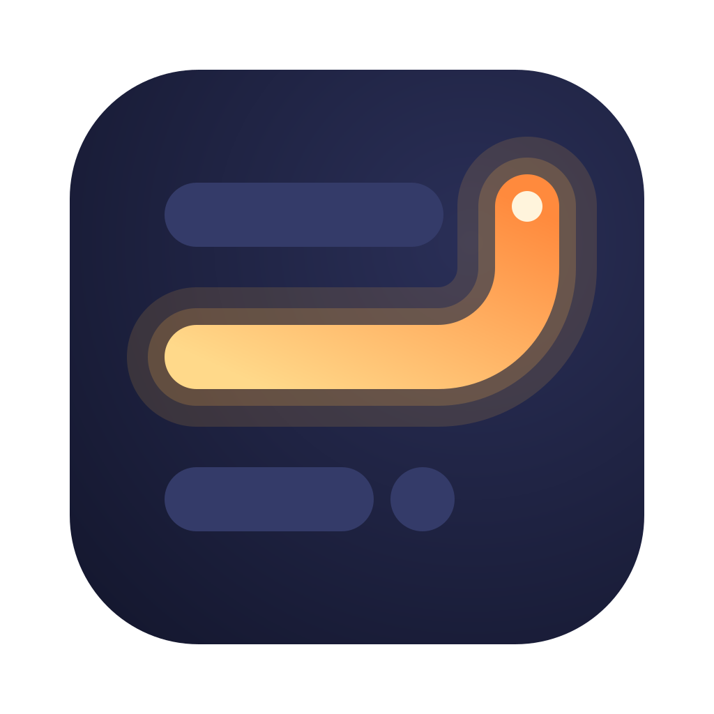
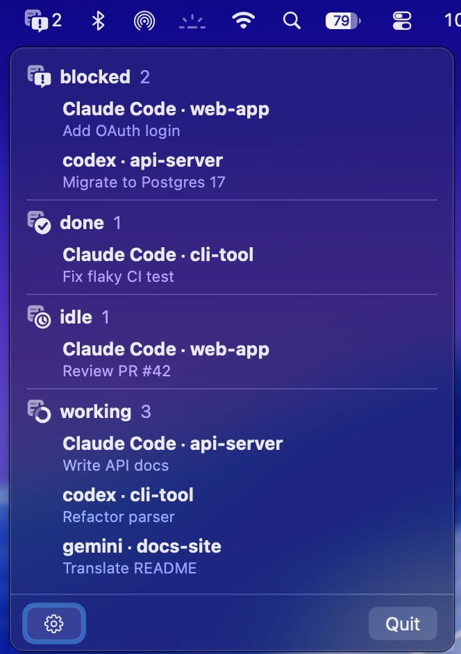
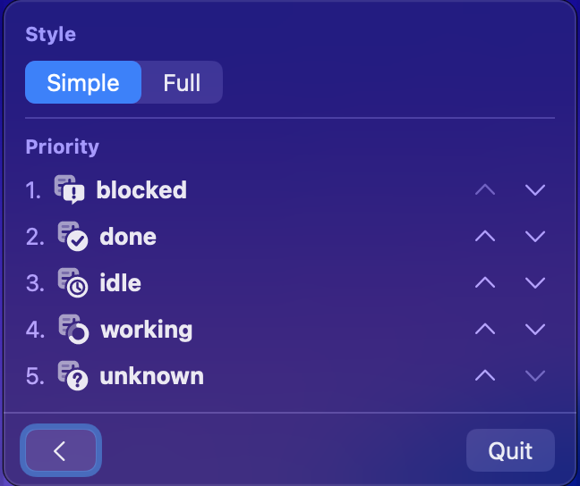

<h1 align="center">
  
  turnray
</h1>

<p align="center">
  <b>See whose turn it is — your AI agents' status, right in the macOS menu bar.</b>
</p>

<p align="center">
  
</p>

turnray watches the AI agents running under herdr and tells you, from the menu bar, which
ones are waiting for you — without changing your terminal layout. The name is *turn*
(your turn) + *tray*.

## Features

- **At-a-glance status** — the menu bar shows how many agents are in each status, most
  urgent first
- **Agent list** — click the icon for every agent with its workspace and title, grouped by
  status
- **Your priority** — reorder the statuses to decide which one the menu bar puts first
- **Live** — updates every second, and warns you when herdr can't be reached

## Requirements

- macOS
- herdr, running ([how turnray finds it](#how-turnray-finds-herdr))

## Install

### Homebrew

```sh
brew install --cask muleyuck/tap/turnray
```

### Manual

1. Download `turnray-<version>.zip` from
   [Releases](https://github.com/muleyuck/turnray/releases) and unzip it
2. Move `turnray.app` to `/Applications`
3. Clear the quarantine flag. The app is ad-hoc signed, not notarized, so Gatekeeper
   blocks it otherwise:

   ```sh
   xattr -dr com.apple.quarantine /Applications/turnray.app
   ```

To start turnray at login, add it in **System Settings > General > Login Items**.

## Usage

### The menu bar

Each agent is in one of five statuses, shown as a badge in front of the app's mark, with
the count of agents in that status right next to it:

| Status      | Badge                       | Meaning                               |
| ----------- | --------------------------- | ------------------------------------- |
| **blocked** | speech bubble with a bang   | waiting for your reply                |
| **done**    | check                       | finished its turn                     |
| **idle**    | clock                       | waiting for its next turn             |
| **working** | progress ring               | at work, nothing for you to do yet    |
| **unknown** | question mark               | herdr itself can't tell               |

Two other icons have no count:

- **The app's mark alone** — no agents
- **A warning triangle** — herdr can't be reached; the panel says why

Choose between two styles in the panel's settings:

| Style      | Shows                                                           |
| ---------- | --------------------------------------------------------------- |
| **Simple** | the most urgent status's badge and its count only               |
| **Full**   | every status that has an agent, each as badge + count, in order |

| Simple | Full |
| :----: | :--: |
|  |  |

### The panel

Click the icon (either button) to open a panel listing every agent — agent, workspace and
title — grouped by status in priority order, each group headed by its badge and count.

- The list is display-only and keeps updating while it is open
- A click elsewhere, <kbd>Esc</kbd> or another click on the icon closes it
- **Quit** is at the bottom of the panel

### Settings

Press ⚙ at the bottom of the panel to switch it to its settings, where you can:

- Pick the style (**Simple** / **Full**)
- Reorder the priority with each status's ↑ and ↓. The default is
  blocked → done → idle → working → unknown. The menu bar and the list share this order,
  so the icon on show is always the head of the list

Settings are saved to `~/Library/Application Support/turnray/settings`.



## How turnray finds herdr

turnray runs `herdr agent list` every second. It looks for `herdr` in these directories,
in order:

1. `/opt/homebrew/bin`
2. `/usr/local/bin`
3. `/opt/local/bin`
4. `/usr/bin`
5. `~/.local/bin`
6. `~/.cargo/bin`

If none has it, turnray falls back to `command -v herdr` in a zsh login shell (`zsh -l`:
`.zprofile` is read, `.zshrc` is not). If the menu bar shows the warning triangle, check
that `herdr` is in one of those places.

## Development

```sh
cargo build --release
./target/release/turnray

make test   # cargo check / test / clippy / fmt
make icons  # re-render assets/*.svg to the embedded PNGs (needs: brew install resvg)
```

Logs go to stderr when launched from a terminal:

```sh
RUST_LOG=debug ./target/release/turnray
```

See [AGENTS.md](AGENTS.md) for the code layout and conventions.
